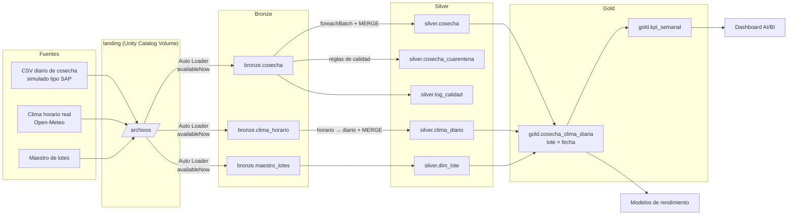
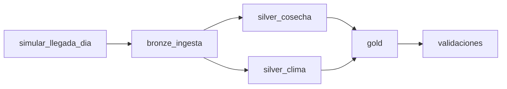

# Agro Lakehouse en Databricks — cosecha × clima con arquitectura medallion

> *Incremental medallion pipeline on Databricks (Auto Loader, Delta Lake, MERGE, Workflows) joining daily harvest files with real hourly weather from Peruvian agricultural valleys.*

Pipeline de datos **incremental, idempotente y con control de calidad** que integra archivos diarios de cosecha de arándano con clima horario real de tres valles agroexportadores del norte del Perú (Chao, Virú, Olmos), y produce tablas analíticas a nivel **lote × fecha** listas para dashboards y modelos de rendimiento.

**Proyecto personal de portafolio.** Los datos de cosecha son **sintéticos** (generados con errores realistas sembrados a propósito); el clima es **real** (Open-Meteo). No contiene datos de ninguna empresa.

---

## Problema que resuelve

En agroexportación, la cosecha diaria llega en archivos exportados de sistemas como SAP, con problemas típicos: formatos de fecha distintos, registros reenviados o corregidos al día siguiente, lotes mal digitados y kilos imposibles. Al mismo tiempo, el clima (calor, VPD, grados día) explica buena parte de la variación del rendimiento, pero vive en otra fuente y con otro grano (horario).

Este pipeline:
1. Ingiere **solo lo nuevo** cada día, sin reprocesar ni duplicar.
2. Separa lo válido de lo inválido **sin perder registros** (cuarentena con motivo).
3. Convierte el clima horario en indicadores agronómicos diarios.
4. Une ambos a nivel lote × fecha con ventanas móviles correctas.
5. **Falla a propósito** si los datos no cumplen las reglas, antes de publicar.

## Arquitectura



### Orquestación (Databricks Workflows)



`silver_cosecha` y `silver_clima` corren **en paralelo**. Si `validaciones` falla, el Job queda en rojo.

## Tablas

| Capa | Tabla | Grano | Cómo se carga |
|---|---|---|---|
| Bronze | `cosecha`, `clima_horario`, `maestro_lotes` | Fila del archivo | Auto Loader, todo `STRING` + `_archivo_origen`, `_fecha_ingesta` |
| Silver | `cosecha` | `id_registro` | Stream + `foreachBatch` + `MERGE` (gana la carga más reciente) |
| Silver | `cosecha_cuarentena` | `id_registro` × archivo | `MERGE` insert-only, con `motivo_rechazo` |
| Silver | `clima_diario` | estación × fecha | Agregación horario → diario + `MERGE` |
| Silver | `dim_lote` | lote | Overwrite (tabla chica) |
| Silver | `log_calidad` | corrida | Append: recibidas, válidas, rechazadas por motivo, duplicadas |
| Gold | `cosecha_clima_diaria` | lote × fecha | Overwrite: kg/ha, pasadas, clima del día y de los últimos 7 días, GDD acumulado |
| Gold | `kpi_semanal` | semana × valle × variedad | Overwrite: toneladas, kg/ha, lotes cosechados |

## Decisiones de diseño

| Decisión | Por qué |
|---|---|
| **Bronze todo en texto** | Un dato mal escrito no rompe la ingesta ni se pierde; el tipado vive en silver con `try_cast` / `try_to_timestamp`. |
| **Auto Loader con `availableNow`** | Incremental (checkpoint recuerda qué archivos ya leyó) pero corre como batch: ideal para un Job diario con cómputo serverless. |
| **`MERGE` por clave de negocio** | Re-ejecutar no duplica (idempotente). Un registro reenviado con kilos corregidos actualiza al anterior solo si su `fecha_carga` es más reciente. |
| **Cuarentena en vez de borrar** | Nada se pierde: la validación `bronze = silver ∪ cuarentena` lo comprueba en cada corrida. |
| **Ventanas móviles antes del join** | Las cosechas caen cada 3-4 días. Si la ventana de 7 días se calculara después de unir con cosecha, serían 7 *cosechas*, no 7 *días*. |
| **Gold con overwrite** | Tablas chicas y derivadas: reconstruirlas es simple, idempotente y evita bugs de lógica incremental. |
| **kg/ha = Σ kilos / Σ área** | Promediar kg/ha de lotes daría el mismo peso a un lote de 2 ha que a uno de 6 ha. |
| **Validaciones que fallan el Job** | Mejor un Job en rojo que un dashboard con datos malos. |

## Reglas de calidad (silver.cosecha)

| Regla | Motivo en cuarentena |
|---|---|
| `id_registro` nulo | `id_nulo` |
| Lote vacío | `lote_vacio` |
| Lote no existe en el maestro | `lote_inexistente` |
| Fecha no parseable (se aceptan `yyyy-MM-dd` y `dd/MM/yyyy`) | `fecha_invalida` |
| Fecha de cosecha posterior a la fecha de carga | `fecha_futura` |
| Kilos nulos o negativos | `kilos_negativos_o_nulos` |
| Más de 2,500 kg/ha en un registro | `kilos_fuera_de_rango` |
| Registro repetido | Se deduplica (no es rechazo): gana la `fecha_carga` más reciente |

## Cómo ejecutarlo (Databricks Free Edition)

1. **Clima:** en tu PC, `pip install requests pandas` y `python scripts/descargar_clima_open_meteo.py` → genera `data/clima/*.csv`.
2. **Repo en Databricks:** *Workspace → Create → Git folder* → URL de este repositorio.
3. Ejecutar `notebooks/00_setup` (crea esquemas `landing/bronze/silver/gold` y Volumes).
4. **Subir clima:** *Catalog → workspace → landing → archivos → Upload to this volume* → carpeta `clima/`.
5. Ejecutar `01_simular_cosecha` con `modo = historico` (genera ago–nov 2025).
6. Ejecutar en orden `02` → `03` → `04` → `05` → `06`.
7. **Job:** *Jobs & Pipelines → Create job* con las tareas de [`jobs/agro_lakehouse_job.json`](jobs/agro_lakehouse_job.json) (o `databricks jobs create --json @jobs/agro_lakehouse_job.json`). Cada corrida simula la llegada de un nuevo día.
8. **Dashboard:** crear un AI/BI Dashboard con las consultas de [`sql/dashboard.sql`](sql/dashboard.sql).

## Estructura

```
├── notebooks/
│   ├── 00_setup.py              # esquemas y volumes
│   ├── 01_simular_cosecha.py    # archivos diarios con errores sembrados
│   ├── 02_bronze_ingesta.py     # Auto Loader → bronze
│   ├── 03_silver_cosecha.py     # foreachBatch + MERGE + cuarentena + log
│   ├── 04_silver_clima.py       # horario → diario agronómico
│   ├── 05_gold.py               # lote × fecha + KPI semanal
│   └── 06_validaciones.py       # reglas que fallan el Job
├── scripts/descargar_clima_open_meteo.py
├── jobs/agro_lakehouse_job.json
└── sql/dashboard.sql
```

## Stack

PySpark · Delta Lake · Auto Loader · Structured Streaming (`foreachBatch`) · Unity Catalog (Volumes) · Databricks Workflows · AI/BI Dashboards · Python (pandas, requests)

## Próximos pasos

- Migrar silver a **Lakeflow Declarative Pipelines** con *expectations* nativas.
- Despliegue con **Databricks Asset Bundles** + GitHub Actions (CI/CD).
- Versión en **Azure** (ADLS Gen2 + Azure Databricks + Data Factory).
- Modelo de rendimiento (kg/ha) sobre `gold.cosecha_clima_diaria` con validación temporal.

## Créditos

- Clima: [Open-Meteo](https://open-meteo.com/) — Historical Weather API, licencia [CC BY 4.0](https://creativecommons.org/licenses/by/4.0/).
- Autor: **Enrique Antonio Mosqueira Rubio** · [LinkedIn](http://linkedin.com/in/enriquemosqueira)
